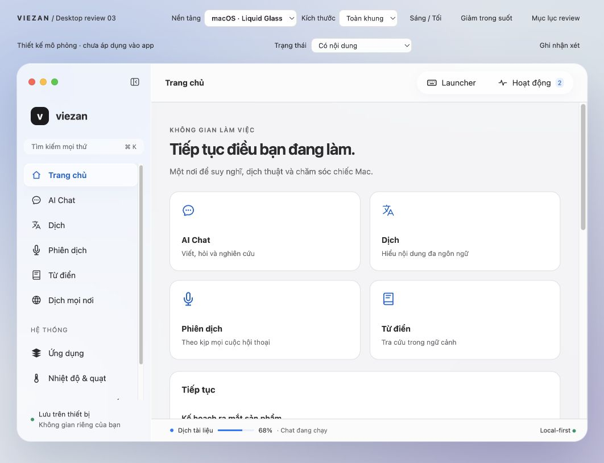
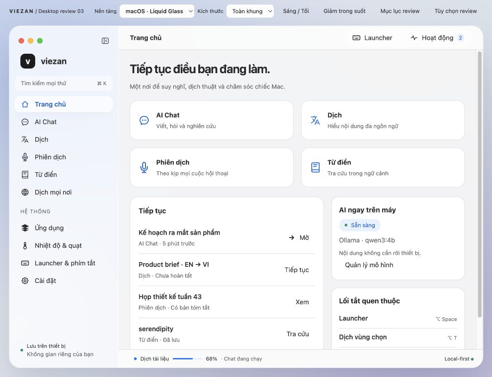
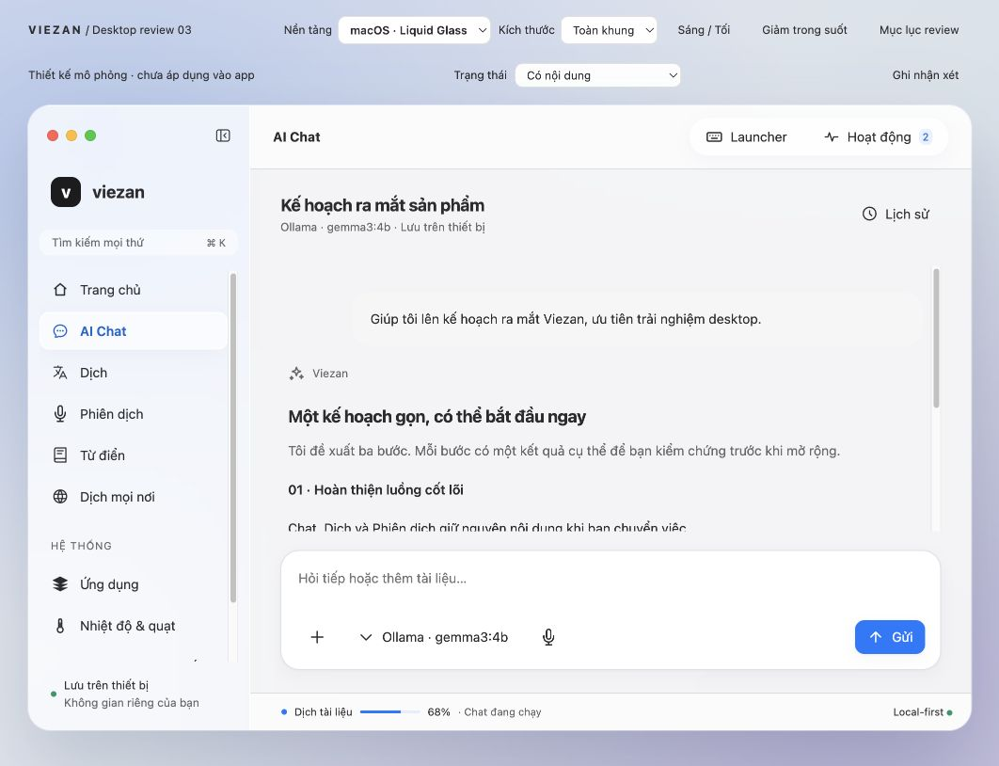
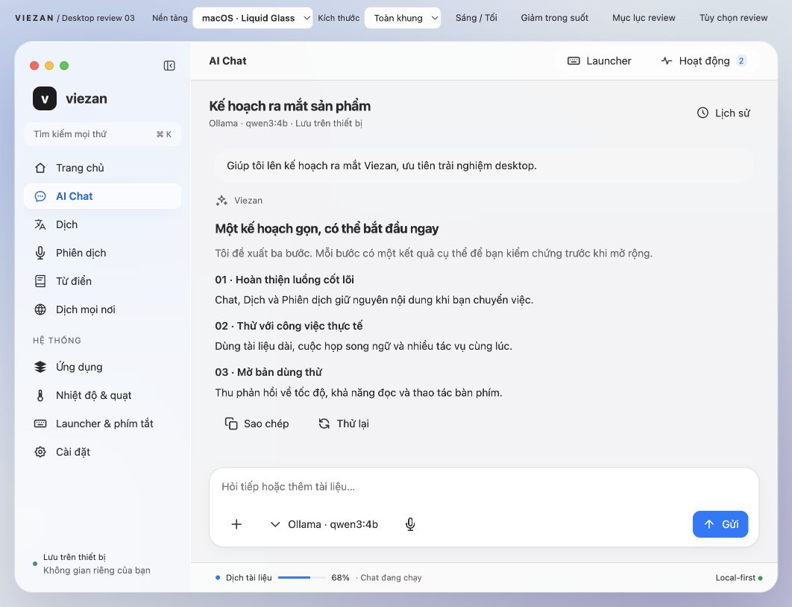
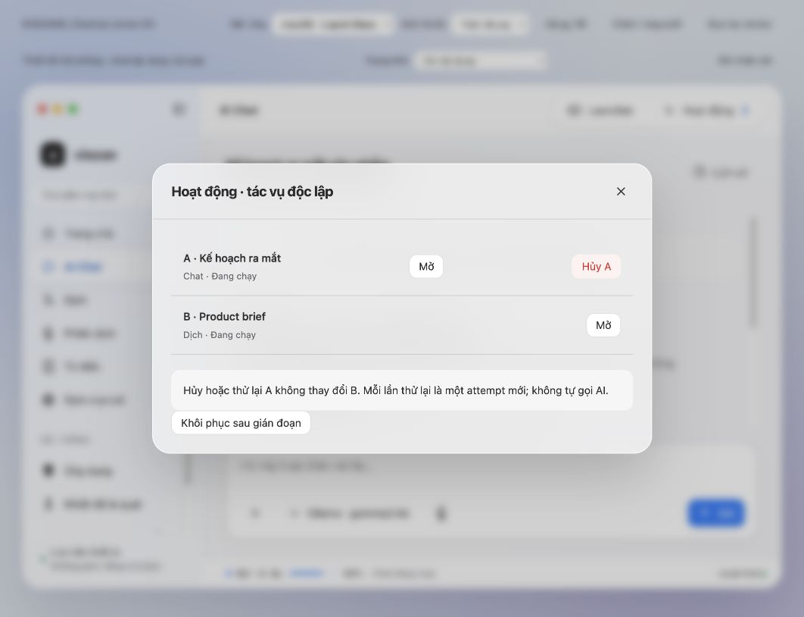
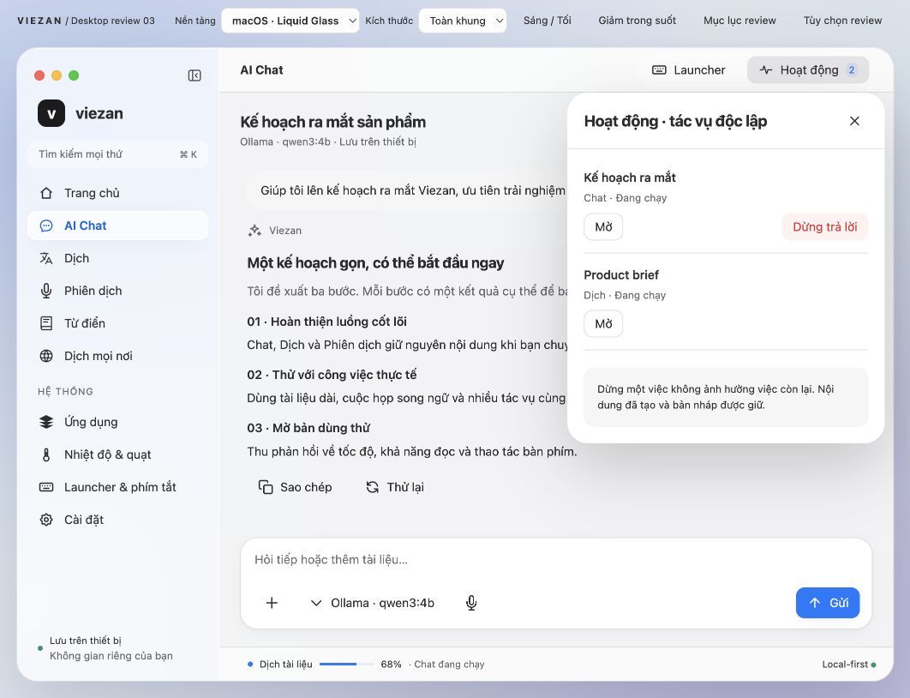

# Review thiết kế — chưa đạt cổng chốt

Audit trực tiếp trong in-app browser, ngày 2026-10-26. Phạm vi: macOS prototype,
luồng Home → Chat → Hoạt động → Dịch. Chỉ dùng ảnh chụp mới trong phiên audit này.
Các kiểm tra nội dung của Review 03 không chứng minh chất lượng UX/visual.

## 1. Bắt đầu công việc — cần sửa, đã cải thiện mật độ

**P1:** Thẻ mở module chiếm phần lớn viewport, công việc gần đây nằm dưới nếp gấp.
Sidebar phải cuộn, Cài đặt bị giấu trong khi còn nhiều khoảng trống ở nội dung.
Thanh công cụ review hai hàng cũng lấy diện tích khỏi phần đang nghiệm thu.

Điểm tốt: tên module rõ, biểu tượng và tên đi cùng nhau. Rủi ro accessibility:
scroll lồng nhau khiến người dùng bàn phím khó xác định vùng đang cuộn. Chưa test
screen reader. Sửa: thu nhỏ entry cards, giảm vùng đầu, giữ status sidebar gọn,
gộp scenario/notes vào Tùy chọn review. Không giảm kích thước chữ navigation.

Ở viewport audit, công việc gần đây và Cài đặt đã xuất hiện ngay. Vẫn cần review
Home có thực sự cần bốn entry cards khi sidebar đã có cùng điểm vào hay không.

## 2. Đọc và tiếp tục Chat — cần sửa, đã cải thiện vùng đọc

**P1:** Header, khoảng cách giữa block và composer chiếm quá nhiều chiều cao.
Đoạn trả lời ngắn vẫn phải cuộn; điều này bất lợi với ứng dụng đọc/viết lâu.
Điểm tốt: một composer duy nhất, có nhãn cho attachment/micro, không xóa trong
canvas. Sửa spacing và composer; giữ các control composer 36px.

Ở cùng viewport, cả ba ý của câu trả lời đã nhìn thấy. Chưa xác nhận contrast
bằng số đo, text scaling, IME, VoiceOver hoặc khả năng đọc với tài liệu dài.
Context/history ở chiều rộng trung bình vẫn cần thiết kế kỹ hơn.

## 3. Xem tác vụ và chuyển việc — luồng cũ gây cản trở, đã sửa hành vi

**P1:** Modal làm mờ và khóa công việc hiện tại ngay khi người dùng kiểm tra tác
vụ nền. **P2:** Nhãn Hủy A/B và thuật ngữ attempt là ngôn ngữ kiểm thử, không phù
hợp người dùng. Sửa thành panel cạnh không modal; đặt tên thật cho công việc,
đổi hành động sang Dừng trả lời/Thử lại và bỏ thuật ngữ triển khai khỏi panel.

Đã click Dừng trả lời: Chat thành Đã hủy, Dịch vẫn Đang chạy, badge giảm còn 1.
Đã click Dịch trong primary nav khi panel còn mở: chuyển trang được. Escape được
xử lý cho panel; cần test riêng focus traversal và screen reader trước native.
Panel vẫn phủ một phần nội dung; cần cân nhắc dock đẩy layout ở cửa sổ rộng.

## Kết luận

Bản trước đủ điểm vào để thảo luận phạm vi nhưng **chưa đủ để chốt thiết kế**.
Ba sửa đổi trên là cải thiện có giới hạn trong prototype hiện tại. Chưa kết luận
toàn bộ macOS/Windows/Linux đẹp hoặc dùng tốt. Không tạo app native hay sửa source
Electron. Còn phải review sâu tính liên tục giữa phiên, screen-specific layout,
font/material thực của OS và localization. Không tăng blur/shadow để che vấn đề
phân cấp thông tin. User approval vẫn pending.

Nguồn thay đổi: audit-refinement.css/js, chỉnh copy panel trong platforms.js;
index.html nạp refinement. Ảnh cũ giữ để đối chiếu, không dùng làm bằng chứng
cho phần đã sửa. Node syntax, check:atomic, check:design, check:docs được chạy;
không chạy build/full app tests vì chỉ thay artifact thiết kế.
