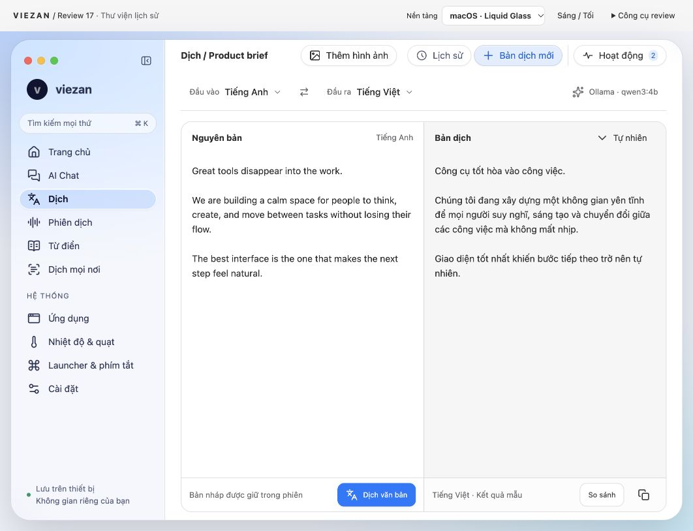
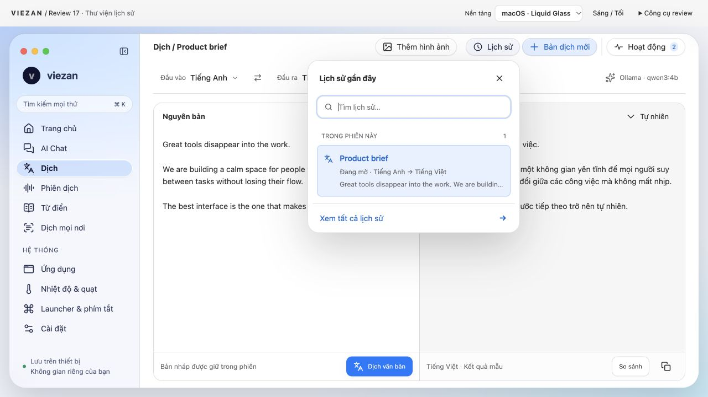
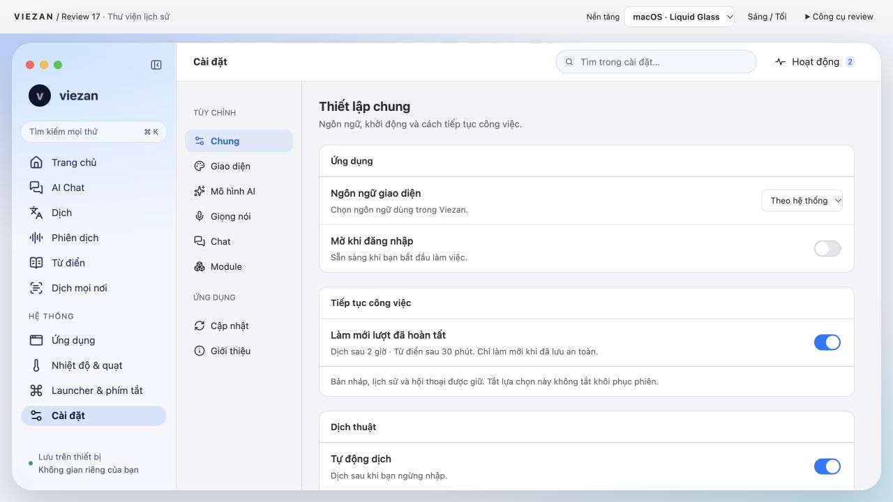
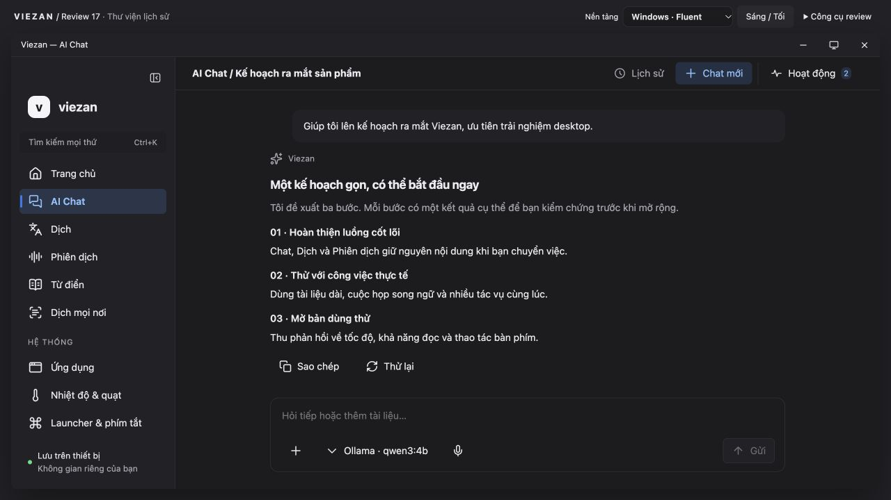
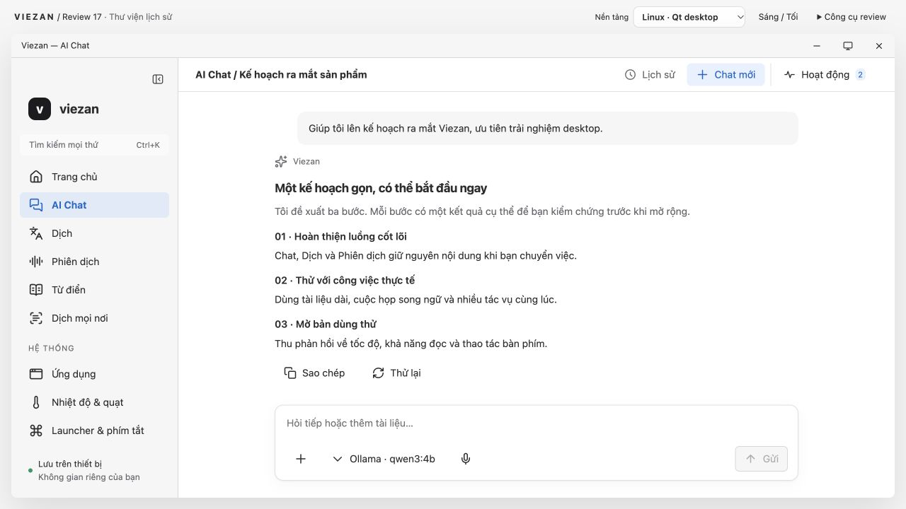
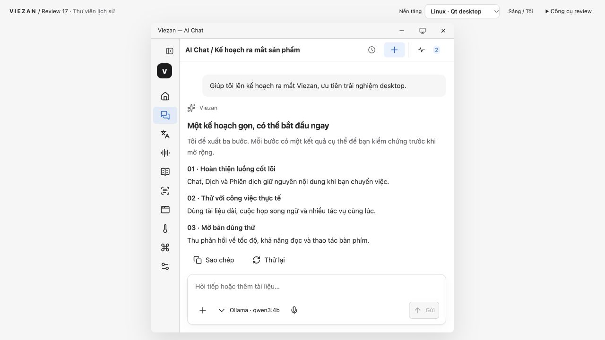
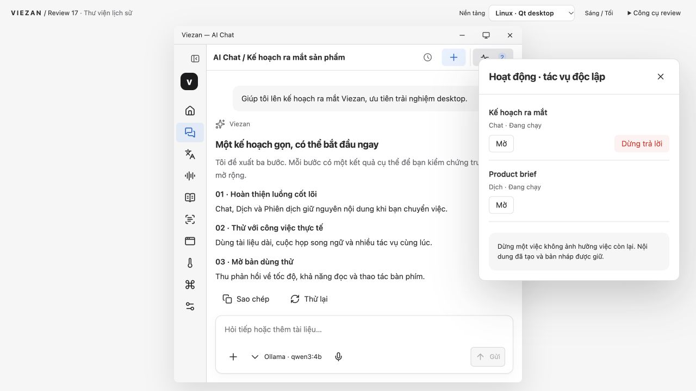

# Audit Review 17 — desktop native readiness

Ngày: 2026-10-26. Phạm vi: prototype localhost:8766 đang mở và source local hiện tại. Không fetch develop, không sửa app/prototype trong lượt này. Các ảnh đều được chụp và đọc lại trong lượt audit này.

Viezan đã có nền tảng UI hiện đại, nhưng chưa nên duyệt thiết kế cuối hoặc gọi là ứng dụng native hoàn chỉnh trên macOS, Windows và Linux. macOS gần hướng mong muốn nhất; Windows/Linux hiện mới là adapter trình bày của prototype web.

## Findings ưu tiên

- P1 — Nút tạo mới mất accessible name ở compact (bước 6). Ảnh và AX/DOM xác nhận; không chỉ là suy đoán từ hình.
- P1 — Activity panel tràn khỏi cửa sổ mô phỏng (bước 7). Không thể dùng bản compact hiện tại để duyệt vị trí overlay.
- P2 — Chưa thể nghiệm thu trạng thái đa nhiệm: panel chỉ có mẫu và hành động hủy không đồng đều giữa các tác vụ (bước 7). Cần chạy/queued/failed/cancelled/interrupted/retry và chuyển phiên không mất draft.
- P2 — Native visual language chưa đủ bằng chứng: CSS glass và đổi theme không chứng minh SwiftUI Liquid Glass, Mica hoặc Qt desktop integration (bước 1, 4, 5).
- P2 — Tài liệu migration còn đề xuất dải phiên trong workbench-ux.md, trong khi hướng review đã bỏ dải này. Cần chốt lại spec trước triển khai.

## Quyết định theo nền tảng

- macOS: giữ canvas đọc ổn định, glass ở điều hướng/toolbar/popover. Ưu tiên SwiftUI/AppKit controls, system typography, SF Symbols tương ứng, focus/keyboard/menu/window semantics; custom glass chỉ khi cần. Swift là ngôn ngữ, không tự làm UI thành native.
- Windows: giữ cùng mô hình công việc, nhưng window chrome/control metrics phải theo Windows. Mica phù hợp lớp nền; Acrylic dành cho transient flyout. Qt FluentWinUI3 là hướng cần spike, không đồng nghĩa dùng WinUI 3 controls thật.
- Linux: giữ Qt/QML theo architecture đề xuất, xác định KDE/Plasma làm mục tiêu chuẩn nếu muốn cảm giác bản địa với Qt. GNOME phải được kiểm tra riêng; không hứa cùng một theme sẽ native trên mọi desktop.

## Những gì đã đối chiếu với source

- package.json vẫn là React/Electron. Swift tìm thấy trong native/ là các helper SMC/files/fanhelper/helperctl; không thấy SwiftUI app hoặc QML app trong lượt kiểm kê này.
- src/components/ui/molecules/HistoryTrigger.tsx đã có accessible label, icon Clock và state. Prototype là nhánh thiết kế độc lập, không phải ảnh của production.
- docs/migration/architecture.md đề xuất SwiftUI/AppKit và Qt/QML; docs/migration/acceptance.md tách nghiệm thu từng OS.
- Prototype platforms.css/platforms.js đổi font stack, caption bar, shape và shortcut; không gọi native APIs.
- Nguồn lỗi compact: unified-history-v13.js tạo .uh-new chỉ có SVG aria-hidden và span; unified-history-v13.css ẩn span ở .preview-narrow.
- Nguồn lỗi Activity: audit-refinement.css neo dialog position:fixed/right:30px; đo DOM xác nhận tràn khỏi khung mô phỏng.

## Gates và giới hạn

- Design: PARTIAL, chưa duyệt cuối; có lỗi P1 trong trạng thái compact.
- Prototype: đã xem bảy trạng thái bên dưới; Escape của history PASS. Chưa bao phủ đủ mọi feature, danh sách lớn, tên dài, zoom 125/150%, VI/JA IME, EN/JA, reduced motion/transparency, contrast measurement.
- Runtime / Release: NOT RUN — không có build SwiftUI/Qt được chạy trên ba OS trong lượt này. Không xác nhận VoiceOver/Narrator/AT-SPI, Snap, Wayland hay hiệu năng.
- UX07: Escape kiểm tra hẹp PASS, IME/screen reader NOT RUN. UX08: compact preview FAIL ở Activity. UX09: chỉ quan sát Mac light, Windows dark, Linux light; full matrix NOT RUN. UX01–06: không có bài nghiệm thu native.
- Không chạy build/test/atomic/design hoặc docs generation: chỉ audit và thêm chứng cứ/báo cáo, không sửa product source. Các lần check cũ không được dùng làm bằng chứng native trong báo cáo này.
- Workflow: native-migration (inventory/design review/verify); rules native-migration và viezan-product-engineering; skills viezan-native-ux, viezan-native-migration, Product Design audit. Sync-docs đầy đủ NOT RUN vì không thay đổi behavior product; chỉ ghi nhận drift liên quan.

## Thứ tự xử lý

1. Sửa hai lỗi compact và chuẩn hóa tên/focus/anchor cho các overlay.
2. Chốt ba bộ quy tắc platform cùng một UX contract, giảm các pill cạnh tranh trong toolbar.
3. Hoàn thiện các trạng thái task, lỗi và khôi phục với dữ liệu nhiều mục.
4. Dựng một lát cắt Chat → Dịch → History trên SwiftUI và Qt bằng fake provider; nghiệm thu trên Mac, Windows, Linux thật trước khi đổi app chính.

## Bằng chứng theo bước

### 1. macOS · Dịch — Tốt về cấu trúc; chưa đạt nghiệm thu native

Tiêu đề liền mạch, input/output và footer thẳng hàng. Sidebar và chrome tách khỏi vùng đọc. Khoảng trống trong editor phù hợp vùng soạn dài; không nên thêm trang trí để lấp đầy. Toolbar còn nhiều pill có cùng độ nổi; nên giảm viền/bóng của tiện ích phụ và ưu tiên toolbar hệ thống.

### 2. Lịch sử nhanh — Hướng tương tác phù hợp

Popover mở dưới nút, không thay trang hoặc phủ scrim, có mục đang mở và Xem tất cả. Escape đóng và trả focus đúng nút trong lượt audit. Hiện chỉ một mục mẫu; chưa nghiệm thu danh sách lớn, tên dài, bàn phím điều hướng danh sách, đổi kích thước khi đang mở.

### 3. Cài đặt — Tốt ở desktop; cần thử khung hẹp

Search rõ, nhóm cài đặt và các hàng có phân cấp. Hai cột điều hướng vẫn có trách nhiệm riêng. Chưa kiểm chứng macOS Settings scene, Command-comma, text scaling, tìm kiếm EN/JA hay screen reader; bản này chỉ là trang prototype.

### 4. Windows · Chat tối — Đọc được; mới là bản mô phỏng

Có caption bar, Ctrl+K, bề mặt phẳng và active navigation. Đây là CSS chạy trong browser trên Mac; font Segoe có thể fallback. Chưa xác nhận Mica, acrylic flyout, contrast themes, Snap, DPI hay Narrator. Dùng chung bố cục là hợp lý nhưng cần Windows controls và window behavior thật.

### 5. Linux · Chat sáng — Nền tảng hợp lý; chưa có bản sắc desktop rõ

Mặt phẳng và viền nhẹ phù hợp công cụ desktop. Nhãn Qt/KDE không chứng minh tích hợp KDE. Cần chốt Plasma là mục tiêu chính của Qt hay chỉ hỗ trợ trung tính; GNOME có convention khác. Chưa kiểm chứng system theme, font, file portal, Wayland, AT-SPI hay decoration thật.

### 6. Linux · khung mô phỏng 640 px — Có lỗi accessibility cần sửa

Rail và vùng đọc/composer co lại hợp lý. Nút Chat mới chỉ còn dấu cộng; accessibility tree trả về button không có tên. DOM .uh-new không có aria-label/title, trong khi span bị display:none. Thêm tên truy cập ổn định, tooltip và kiểm tra các nút icon ở mọi feature. Đây là khung mô phỏng 640 trong viewport 1280×720, không phải Linux thật.

### 7. Hoạt động trong khung hẹp — Chưa đạt layout acceptance

Cửa sổ mô phỏng x=320…960 nhưng bảng Hoạt động x=880…1250: tràn 290 px ra ngoài bên phải. CSS neo dialog theo viewport browser, không theo cửa sổ mô phỏng. Cần neo/clamp theo container ứng dụng. Chat có Dừng trả lời, tác vụ Dịch cùng trạng thái Đang chạy chỉ có Mở: cần làm rõ hoặc bổ sung hành động hủy theo capability; chưa có bằng chứng hai tác vụ chạy thật.

## Nguồn chính thức

- [Apple Materials](https://developer.apple.com/design/human-interface-guidelines/materials)
- [Apple SwiftUI Liquid Glass](https://developer.apple.com/documentation/swiftui/applying-liquid-glass-to-custom-views)
- [Windows materials](https://learn.microsoft.com/en-us/windows/apps/design/signature-experiences/materials)
- [Qt styles](https://doc.qt.io/qt-6.12/qtquickcontrols-styles.html)
- [KDE HIG](https://develop.kde.org/hig/)
- [GNOME HIG](https://developer.gnome.org/hig/)
