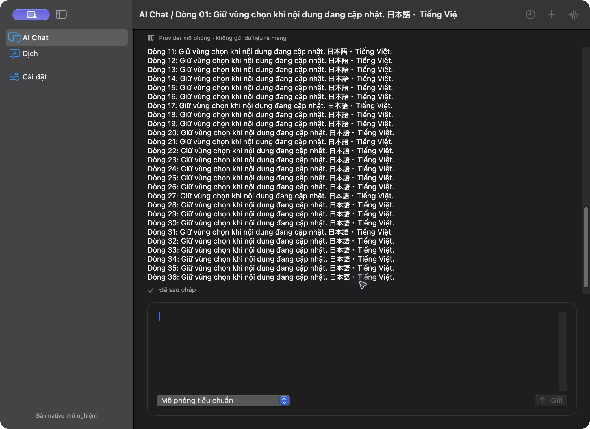
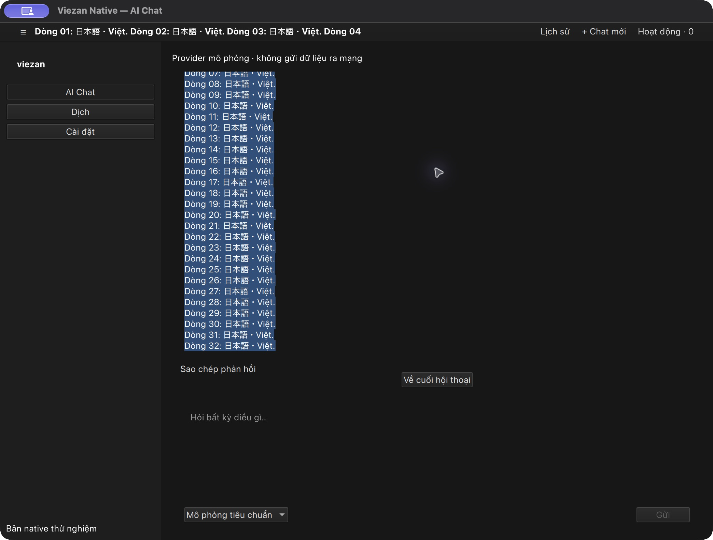

# Implementation 04 — native Chat reading

Date: 2026-10-27. Implements the reading/selection portion of UX04 and parts of
UX08/UX09 in the existing fake-provider native preview. Runtime evidence is from
macOS 27.0.1 arm64. This does not establish Windows/Linux acceptance.

## Interaction contract

- Reading and composing remain separate, opaque surfaces with one composer.
  Message identity is stable during appended output; selection is view-local and
  never written to the workspace or confused with session/task/attempt identity.
- The transcript follows new text while the reader stays at the end. Scrolling
  away or selecting text pauses following. A Back to latest action appears;
  activating it clears the reading selection, moves to the end and resumes follow.
- Every nonempty assistant response offers Copy response, including a partial
  answer. It copies the current response text and shows confirmation. A later
  text update resets confirmation so it cannot describe a different version.
- A new or reopened conversation starts at its end. Changing conversations does
  not cancel the previous task or replace its draft/model. These display changes
  add no provider call, permission, data format or storage path.
- Text is plain text in this slice. Markdown, code-block formatting and attachment
  rendering remain on the migration roadmap.

## Native implementation

SwiftUI keeps one AppKit NSTextView per stable message. Prefix appends update its
text storage and preserve UTF-16 selection ranges; shorter replacement output
clamps ranges safely. Size is measured from native layout at the actual container
width. The surrounding SwiftUI ScrollView owns scrolling, avoiding nested reading
scroll views. Scroll-phase handling distinguishes user movement from content
growth. Programmatic selection updates are guarded against view-update callbacks.

Qt uses a persistent ListModel reconciled by message ID. Changed text updates the
existing read-only TextArea through insert/selection restoration instead of
replacing every delegate. The ListView owns following and explicit return to end.
Switching sessions rebuilds that session's view-local rows, while domain state
continues to own tasks, drafts and provider IDs. Both adapters reuse existing
localized labels, system fonts/palettes and canonical structural metrics.

## Actual native captures

SwiftUI at the end of the 36-line response, with the full model label readable:

Qt read selection with the Back to latest action visible:

[Qt Copy confirmation on the existing short conversation](evidence/qt-chat-copy-04.png).
Qt captures use Fusion on macOS, not Windows Fluent or a Linux compositor.

## Verification and residual gates

| Check | Actual result |
| --- | --- |
| Swift build/tests | PASS: 14 domain tests plus three AppKit text-view tests, 17 total |
| AppKit behavior | PASS: selected Vietnamese/Japanese/emoji text survives append; retry truncation stays in bounds; font change retains range; narrower layout increases native text height |
| Qt build/CTest | PASS: 25 scenario rows, 27 with init/cleanup |
| Qt reading cases | PASS: VI/EN/JA at wide/640-point; stable native editor pointer, unchanged selected text/contentY after append, explicit end clears selection, session switching keeps the background task and draft |
| Node contract/resource tests | PASS: nine tests, including locale coverage for the new QML component |
| Biome, both TypeScript targets, Atomic/Design | PASS; native values also checked manually because React scanners do not cover Swift/QML |

Direct macOS checks in both apps exercised completed long responses, native
selection, return to end and copy confirmation. SwiftUI's copied response was
pasted back into an empty test draft and matched all 2,564 characters; that draft
was cleared afterward. Qt's copied response was pasted into a separate test
conversation before entering its long fixture. Existing work was preserved.

An automation timeout during the SwiftUI stream initially looked like an app
hang. The exact preview process sampled at 0% CPU with its main thread waiting
for events; later UI inspection showed the complete response. Reconnecting by
bundle ID recovered control. No forced quit, crash recovery or hang fix is claimed.
The full interactive stress scenario during an active stream remains partial;
the automated native append/selection checks are the stronger evidence here.

NOT RUN: real Windows/Linux hosts, all OS scroll/selection gestures, complete
screen-reader traversal, live VI/JA IME, full manual compact/text-scaling matrix,
sleep/lock/crash, large-history performance and real AI providers. Fable review
still has no successful result after the earlier authentication failure.

API references: [Apple scroll phase context](https://developer.apple.com/documentation/swiftui/scrollphasechangecontext),
[Qt text editing and selection](https://doc.qt.io/qt-6/qml-qtquick-textedit.html),
[Qt persistent list model](https://doc.qt.io/qt-6/qml-qtqml-models-listmodel.html).
