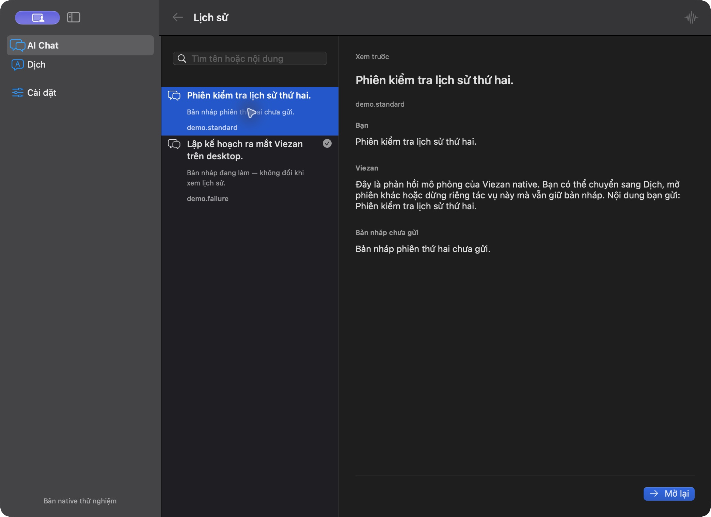
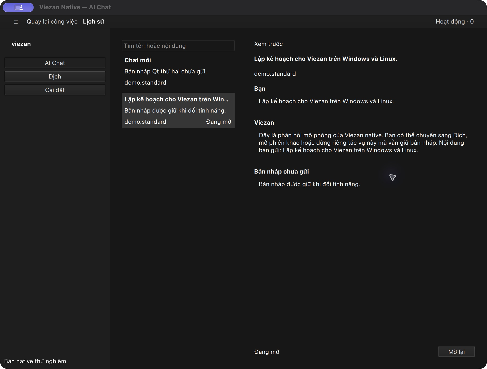

# Implementation 02 — native history

Date: 2026-10-26. Continues the user's request to implement the reviewed desktop
design. This is the fake-provider native preview, not a production migration.

## Interaction

- History stays in the feature toolbar on SwiftUI and Qt. Its quick popover
  supports search, arrow-key selection, Return to open, and Escape to close.
- The selected search result and the currently open session are separate states.
  A current-session marker identifies the latter without relying on color alone.
- The full library shows a list and an opaque, read-only preview. Chat previews
  include messages and the unsent draft; Translation shows source and result.
- Selecting a library row or searching does not activate it. Open is explicit;
  Back preserves the active session and draft. No matches removes the previous
  preview and makes opening it unavailable.
- Narrow library containers stack the list and preview. Preview content scrolls
  independently of its Open action. Controls use native palettes and typography;
  structural spacing continues to come from the canonical generated metrics.
- New labels are available in English, Vietnamese and Japanese. Native search
  keeps composition with the platform text editor rather than treating marked
  text as a navigation command.

## Actual app captures

SwiftUI/AppKit on macOS 27.0.1: another session is selected for preview while the
checkmark still identifies the current session. The draft has its own section.

Qt 6.12 using Fusion on macOS: the preview can show a draft-only conversation.
This is adapter evidence on macOS, not a Windows or Linux screenshot.

## Verification and limits

Rebuilt both native apps. Swift tests: 11 passed. Qt tests: 12 scenario rows
passed (14 including init/cleanup). Seven Node domain/contract tests, resource
freshness, both TypeScript checks, focused Biome and Atomic/Design checks passed.
React scanners do not inspect native views; native values were reviewed manually.

Direct app checks covered multi-result keyboard opening, draft preservation,
current-versus-preview selection, Back and SwiftUI explicit Open. The Qt tests
add non-mutating preview, empty-filter invalidation, and 640-point layout/action
bounds. The [verification record](verification.md) distinguishes these automated
checks from direct observations.

Still pending: real Windows/Linux hosts, a full manual 640-point pass, large
text, light/reduced-transparency appearance, screen readers and live VI/JA IME.
SwiftUI library search focus and returning focus to the toolbar need further
verification. Native popover placement must be assessed on-screen at compact
widths, since window captures may omit the part outside the host window.

No production providers, data migration, history deletion/rename/export, or
remaining product modules were added. Claude/Fable review remains unavailable
after the earlier authentication failure; this report does not attribute any
review findings to that model.
