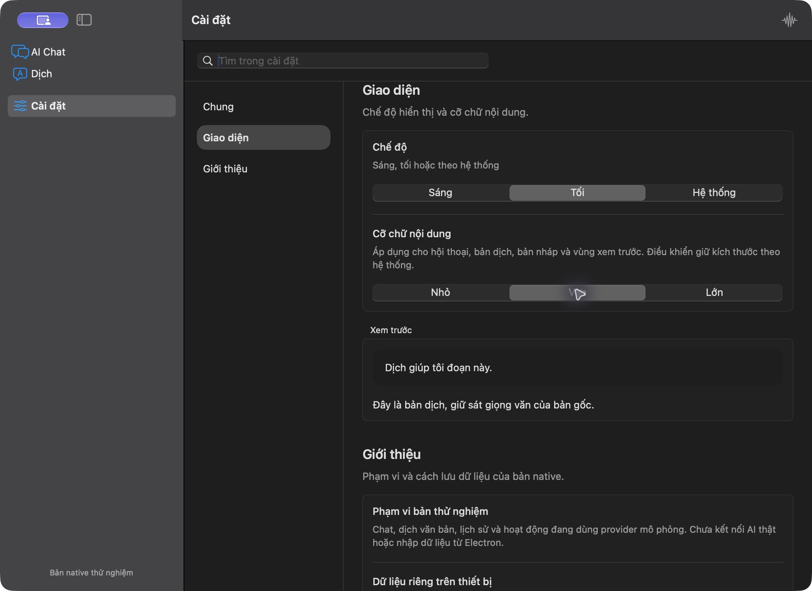
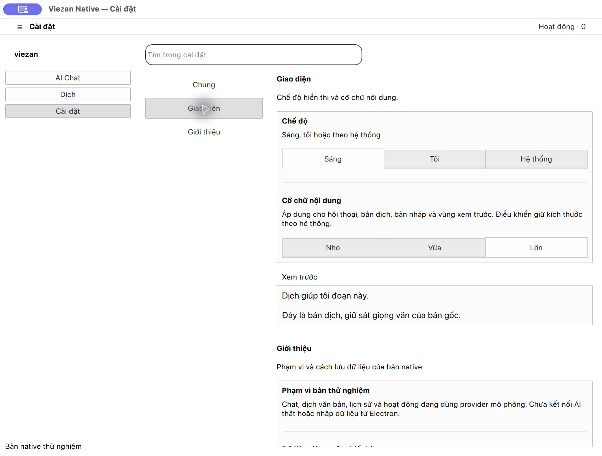

# Implementation 03 — native settings workspace

Date: 2026-10-27. Native preview with simulated providers. Continues the user's
request to implement the reviewed desktop design. General, Appearance and About
are connected; the remaining product settings are outside this increment.

## Interaction and layout

- One full workspace with search and section navigation. Content scrolls
  independently. In narrow containers the section list becomes a menu, keeping
  the content usable beside primary navigation.
- Search includes localized section descriptions and row labels. Vietnamese
  queries work without diacritics. No matches has an explicit empty state;
  clearing the query restores the sections. Escape clears an uncommitted search
  command only when the text editor is not composing marked text.
- General changes interface language and explains draft/task recovery. About
  identifies the actual preview scope and isolated local storage.
- Appearance offers Light, Dark and System through native controls/palettes.
  Content text offers Small, Medium and Large. The preview reflects changes
  immediately. Conversations, translations, composers and library previews use
  the selected size; control labels keep the native platform size.
- SwiftUI uses the application menu and ⌘, to open this workspace. Qt uses the
  platform Preferences shortcut; ⌘, was exercised on this macOS host. This does
  not establish Windows/Linux shortcut availability or discoverability.
- Settings changes have no page-level Save button. They use the existing atomic
  snapshot and visible save-failure/retry path. They never change session identity,
  drafts, model IDs, language pairs or in-flight request snapshots.

The scales come from canonical `tokens.css` factors (0.9, 1, 1.15), multiplied by
each platform's body font. This setting is content scaling, not full application
or OS accessibility text scaling. Existing v1 snapshots without appearance data
default to System/Medium. Invalid saved values block recovery; invalid commands
do not change preferences.

## Actual native screenshots

SwiftUI/AppKit on macOS 27.0.1, dark with medium text:

[SwiftUI light with large content text](evidence/macos-settings-light-03.png).

Qt 6.12/Fusion on macOS, light with large content text:

[Qt dark with medium text](evidence/qt-settings-dark-03.png).
Qt captures here establish the macOS adapter only.

## Verification

| Gate | Actual result |
| --- | --- |
| Swift build/tests | PASS, 14 tests. Added appearance/session isolation, persistence/save failure, old-snapshot defaults, invalid data, localized row search and canonical scale ordering |
| Qt build/CTest | PASS, 19 scenario rows, 21 with init/cleanup. Added atomic preference roundtrip/isolation and six settings QML cases: VI/EN/JA, wide/640 points, large content text, search and empty/clear states |
| Node contract/resource tests | PASS, 9 tests. Includes old-snapshot compatibility, invalid appearance and locale/appearance changes during running work |
| Generated resources | PASS, identical catalogs, structural metrics, section metadata and text scales |
| Electron/renderer types, Biome, Atomic/Design | PASS. Native values additionally reviewed manually; React scanners do not inspect Swift/QML |

Direct native checks in both apps: Light/Dark visibly changed the window, content
size changed the sample, `co chu` found Appearance, an unmatched query showed the
empty state, and returning to Chat retained the same conversation/model/draft.
Both apps were quit normally, confirmed stopped through app inventory, and
reopened. Light/Large preferences and drafts were restored. SwiftUI also restored
Japanese interface language; language was returned to Vietnamese after review.
The Preferences shortcut opened Settings in both rebuilt apps. Initial search
focus and selected values were observed through native accessibility trees.
Review state was returned to System/Medium/Vietnamese in both apps.

QML tests first searched the QObject ownership tree for controls created by a
Loader; that lookup did not represent their actual hierarchy. Tests now traverse
the visual tree to inspect the displayed controls and check window bounds. Native
inspection also prompted a clearer SwiftUI selected section and neutral Qt search
focus, plus a common control height for appearance choices.

## Remaining gates

- Windows/Linux hosts, their theme/shortcut behavior, DPI, Wayland and packaging.
- Full manual 640-point layout, large OS text, high contrast, Reduce Transparency
  and Motion, live Vietnamese/Japanese IME and full screen-reader navigation.
- Changing the OS theme while System is selected was not exercised. Qt's color
  scheme override is a hint and may depend on the host integration.
- The native preview has no persona/accent editor, secure provider configuration,
  speech/module/update settings, production AI or Electron data import.
- Fable review still has no successful result after the earlier authentication
  failure. No findings in this increment are attributed to that model.

Implementation APIs: [Apple preferredColorScheme](https://developer.apple.com/documentation/swiftui/view/preferredcolorscheme(_:))
and [Qt QStyleHints color scheme](https://doc.qt.io/qt-6/qstylehints.html#colorScheme-prop).
Runtime and release acceptance remain separate from this design implementation.
