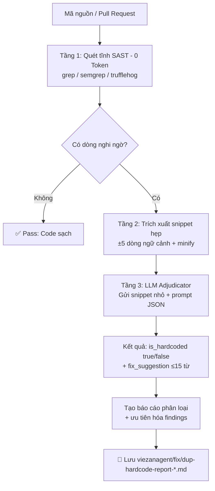

# Workflow: check-dup-hardcode `v2.0.0`

Workflow kiểm tra **duplicate code** và **hardcode** trong source code theo kiến trúc **Phễu lọc 3 tầng**, tạo báo cáo có phân loại mức độ nghiêm trọng và kế hoạch refactor cụ thể — với mức tiêu thụ token AI thấp nhất có thể.

---

## Kiến trúc: Phễu lọc 3 tầng (Token-Optimal Pipeline)

> **Nguyên tắc cốt lõi:** Tuyệt đối không gửi toàn bộ source code cho AI. Dùng công cụ tĩnh để lọc trước, chỉ đưa snippet hẹp vào LLM.



| Tầng | Tên | Token cost | Công cụ |
|------|-----|-----------|---------|
| 1 | Static Pre-filter | **0 token** | `grep`, `semgrep`, `trufflehog`, `eslint` |
| 2 | Context Extraction | Minimal | Line-range ±5, AST parser, minification |
| 3 | LLM Adjudicator | Low | AI với JSON-only output prompt |

---

## Mô tả

Workflow hướng dẫn AI agent thực hiện toàn bộ quy trình phân tích từ đầu đến cuối:

```
Step 0: Pre-filter tĩnh (grep scan, 0 token) → suspected_lines
   ↓
Step 1: Xác định phạm vi kiểm tra
   ↓
Step 2: Đọc snippet ±5 dòng từ suspected_lines (không đọc toàn file)
   ↓
Step 3: Phát hiện Duplicate Code (dùng skill check-dup-hardcode)
   ↓
Step 4: LLM Adjudicator xác minh Hardcode (dùng skill check-dup-hardcode)
   ↓
Step 5: Loại bỏ trùng lặp & false positive trong findings
   ↓
Step 6: Ưu tiên hóa vấn đề theo severity
   ↓
Step 7: Tạo báo cáo đầy đủ
   ↓
Step 8: Lưu báo cáo vào viezanagent/fix/
```

---

## Cách kích hoạt

```
Hãy dùng workflow check-dup-hardcode để kiểm tra source code trong [thư mục / file / toàn bộ project]
```

hoặc chỉ định loại kiểm tra:

```
Hãy dùng workflow check-dup-hardcode để kiểm tra duplicate code trong src/services
Hãy dùng workflow check-dup-hardcode để kiểm tra hardcode trong toàn bộ electron/ipc
```

---

## Tầng 1: Lệnh grep Pre-filter (Zero Token)

Chạy các lệnh này trước — **không tốn token** — để khoanh vùng dòng code nghi ngờ:

```bash
# 🔴 Critical: API Key / Secret / Credential
grep -rn --include='*.ts' --include='*.tsx' --include='*.js' \
  -E "(api[_-]?key|secret|password|token|credential)\s*=\s*['\"][^'\"]{8,}" \
  src/ electron/

# 🟡 Medium: Hardcode URL / Endpoint
grep -rn --include='*.ts' --include='*.tsx' \
  -E "['\"](https?://[^'\"]+)['\"]" \
  src/ electron/

# 🟠 High: Magic Number (timeout, port, limit, size)
grep -rn --include='*.ts' --include='*.tsx' \
  -E "(setTimeout|setInterval|port|limit|size|delay)\s*[,(]\s*[0-9]{3,}" \
  src/ electron/

# 🟠 High: SVG inline ngoài ui/icons
grep -rn --include='*.tsx' '<svg' src/ | grep -v 'ui/icons/'

# 🟠 High: Icon library import vi phạm
grep -rn --include='*.ts' --include='*.tsx' \
  -E "from '(lucide-react|react-icons|@heroicons|@phosphor-icons)" \
  src/ | grep -v 'ui/icons/'

# 🟠 High: Magic String phổ biến
grep -rn --include='*.ts' --include='*.tsx' \
  -E "===\s*['\"][a-zA-Z_-]{3,}['\"]" \
  src/ electron/

# 🟢 Low: Hardcode color / hex
grep -rn --include='*.ts' --include='*.tsx' --include='*.css' \
  -E "#[0-9a-fA-F]{3,6}" src/
```

---

## Tầng 3: LLM Adjudicator — Prompt Template

Sau khi có snippet ±5 dòng từ Tầng 2, gửi cho LLM với prompt sau:

**System Prompt:**
```
Bạn là công cụ kiểm tra bảo mật. Đánh giá đoạn mã JSON dưới đây. 
Trả về đúng định dạng JSON có khóa `is_hardcoded` (true/false) và `fix_suggestion` (tối đa 15 từ). 
Không giải thích thêm.
```

**User Payload:**
```json
{
  "file": "src/services/chatService.ts",
  "lines": "42-48",
  "code": "const apiKey = 'sk-abc123xyz789';\nconst response = await fetch(url, { headers: { Authorization: `Bearer ${apiKey}` } });"
}
```

**Expected Response:**
```json
{
  "is_hardcoded": true,
  "fix_suggestion": "Move to import.meta.env.VITE_OPENAI_API_KEY"
}
```

---

## Phạm vi kiểm tra

| Tùy chọn | Mô tả |
|----------|-------|
| **Toàn bộ codebase** | Tất cả file source, bỏ qua node_modules/dist/build |
| **Một folder** | Ví dụ: `src/services`, `electron/ipc` |
| **Danh sách file** | Người dùng chỉ định file cụ thể |

---

## Skill được sử dụng

Workflow này gọi **skill `check-dup-hardcode`** ở 2 bước:

| Bước | Skill Category | Mục tiêu |
|------|---------------|----------|
| Step 3 | `duplicate-code` | Tìm 4 loại clone |
| Step 4 | `hardcode` | Xác minh findings từ pre-filter + phân tích ngữ nghĩa |

---

## Bảng phân loại vấn đề

### Duplicate Code

| Loại | Clone Type | Severity | Dấu hiệu |
|------|-----------|----------|----------|
| Exact Duplicate | Type 1 | 🔴 Critical | Body giống hệt nhau |
| Near Duplicate | Type 2 | 🟠 High | Chỉ khác tên biến |
| Structural Duplicate | Type 3 | 🟡 Medium | Cùng flow, khác vài dòng |
| Semantic Duplicate | Type 4 | 🟢 Low | Cùng mục đích, implement khác |

### Hardcode

| Loại | Severity | Ví dụ |
|------|----------|-------|
| Hardcode Credential | 🔴 Critical | `const KEY = 'sk-abc123'` |
| Magic Number | 🟠 High | `setTimeout(fn, 3000)` |
| Magic String | 🟠 High | `if (status === 'pending')` |
| Hardcode Icon | 🟠 High | `<svg><path d="M12 2..."/></svg>` inline trong JSX |
| Hardcode Config | 🟡 Medium | `app.listen(3000)` |
| Hardcode URL | 🟡 Medium | `fetch('https://api.example.com/v1/...')` |
| Hardcode UI Value | 🟢 Low | `color: '#FF5733'` |

---

## Quy tắc tránh False Positive

### KHÔNG phải Duplicate nếu:
- Hai hàm serve domain context khác nhau (ví dụ: `validateUser` vs `validatePayment`)
- Code giống nhau nhưng cần tách vì sẽ diverge trong tương lai
- Boilerplate theo convention framework (Redux slice, Zustand slice...)

### KHÔNG phải Hardcode nếu:
- Số `0`, `1`, `-1` trong context rõ ràng (default, flag)
- Chuỗi rỗng `''` làm default value
- Constant đã được define rõ với `const`/`enum`
- Test data trong file `*.test.ts` / `*.spec.ts`
- Class Tailwind theo design system (`p-4`, `text-sm`)
- `<svg>` nằm **bên trong** `src/components/ui/icons/` — đây là icon definition hợp lệ, KHÔNG phải hardcode

---

## Kiểm tra Icon (Step 4 mở rộng)

Trong Step 4, ngoài các hardcode thông thường, bắt buộc kiểm tra thêm:

| Dấu hiệu vi phạm | Cách phát hiện |
|-------------------|----------------|
| `<svg>` inline trong JSX/TSX | `grep -rn "<svg" src/ --include="*.tsx" \| grep -v "ui/icons/"` |
| Import từ `lucide-react`, `react-icons`, v.v. | `grep -rn "from 'lucide-react'" src/ \| grep -v "ui/icons/"` |
| Emoji ký tự dùng làm icon trong UI | Tìm emoji render trong JSX không phải text content |

**Quy tắc sửa icon hardcode:**
1. Kiểm tra `src/components/ui/icons/` — xem `index.ts` để tra cứu icon có sẵn theo category
2. Nếu icon đã có → import và dùng: `import { XxxIcon } from '@/components/ui/icons'`
3. Nếu chưa có → tạo mới icon component trong category file phù hợp (`actions/navigation/media/status/auth/files`), export qua `index.ts`

---

## Format báo cáo

### Từng vấn đề

```markdown
### [🔴 Critical] Hardcode Credential
**File:** `src/services/chatService.ts:42`
**Code:**
```ts
const apiKey = "sk-abc123xyz789"
```
**Vấn đề:** API key bị commit thẳng vào source code, nguy cơ lộ secret khi push lên git public
**Sửa:**
```ts
const apiKey = import.meta.env.VITE_OPENAI_API_KEY
```

---

### [🟠 High] Exact Duplicate
**File 1:** `electron/ipc/translate.ts:28–45`
**File 2:** `electron/ipc/imageTranslate.ts:31–48`
**Code (translate.ts):**
```ts
const headers = { 'Content-Type': 'application/json', ... }
const response = await fetch(url, { method: 'POST', headers, body })
if (!response.ok) throw new Error(...)
```
**Vấn đề:** Logic gọi API lặp lại 100% ở hai file
**Sửa:** Trích xuất thành `src/utils/apiClient.ts`
```

### Bảng tóm tắt

```markdown
## Tóm tắt

| Loại vấn đề         | 🔴 Critical | 🟠 High | 🟡 Medium | 🟢 Low | Tổng |
|---------------------|------------|--------|----------|-------|------|
| Exact Duplicate     | 1          | 0      | 0        | 0     | 1    |
| Near Duplicate      | 0          | 3      | 0        | 0     | 3    |
| Structural Dup      | 0          | 0      | 2        | 0     | 2    |
| Hardcode Credential | 1          | 0      | 0        | 0     | 1    |
| Magic Number        | 0          | 4      | 0        | 0     | 4    |
| Magic String        | 0          | 5      | 0        | 0     | 5    |
| Hardcode Config     | 0          | 0      | 3        | 0     | 3    |
| Hardcode URL        | 0          | 0      | 5        | 0     | 5    |
| Hardcode UI         | 0          | 0      | 0        | 8     | 8    |
| Hardcode Icon       | 0          | 5      | 0        | 0     | 5    |
| **Tổng**            | **2**      | **17** | **10**   | **8** | **37** |

**File bị ảnh hưởng nhiều nhất:** `src/services/translationService.ts` (7 vấn đề)

**Top 3 ưu tiên sửa:**
1. Hardcode credential tại `chatService.ts:42`
2. Exact duplicate logic tại `translate.ts:28` và `imageTranslate.ts:31`
3. Magic string `'pending'` lặp 9 lần trong codebase
```

---

## Lưu báo cáo

```
viezanagent/fix/dup-hardcode-report-{YYYYMMDD}-{HHmm}.md
```

Ví dụ: `viezanagent/fix/dup-hardcode-report-20260426-0305.md`

---

## Tích hợp CI/CD

Tạo file `.github/workflows/hardcode-scan.yml` để kích hoạt workflow tự động trên mỗi Pull Request:

```yaml
name: Hardcode Scan
on: pull_request

jobs:
  scan:
    runs-on: ubuntu-latest
    steps:
      - uses: actions/checkout@v4
      
      - name: Layer 1 - Static pre-filter (0 token)
        run: |
          grep -rn --include='*.ts' --include='*.tsx' \
            -E "(api[_-]?key|secret|password)\s*=\s*['\"][^'\"]{8,}" \
            src/ electron/ > suspected_credentials.txt || true
          grep -rn --include='*.tsx' '<svg' src/ | grep -v 'ui/icons/' \
            >> suspected_icons.txt || true
      
      - name: Layer 2 - Extract snippets
        run: |
          # Script: đọc suspected_*.txt, extract ±5 dòng, minify
          python3 scripts/extract-snippets.py
      
      - name: Layer 3 - LLM Adjudicator
        env:
          OPENAI_API_KEY: ${{ secrets.OPENAI_API_KEY }}
        run: |
          # Gửi snippets tới LLM, nhận JSON {is_hardcoded, fix_suggestion}
          python3 scripts/llm-adjudicator.py
      
      - name: Comment violations on PR
        uses: actions/github-script@v7
        with:
          script: |
            // Parse kết quả và comment vào PR nếu is_hardcoded: true
```

> **Gợi ý bảo mật:** Dùng Local LLM (Ollama + LLaMA 3.2) trong CI runner tự host để giảm chi phí API xuống 0 và không lộ source code ra ngoài.
